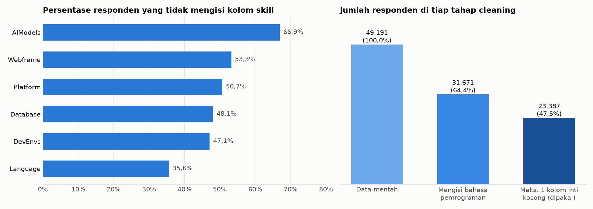
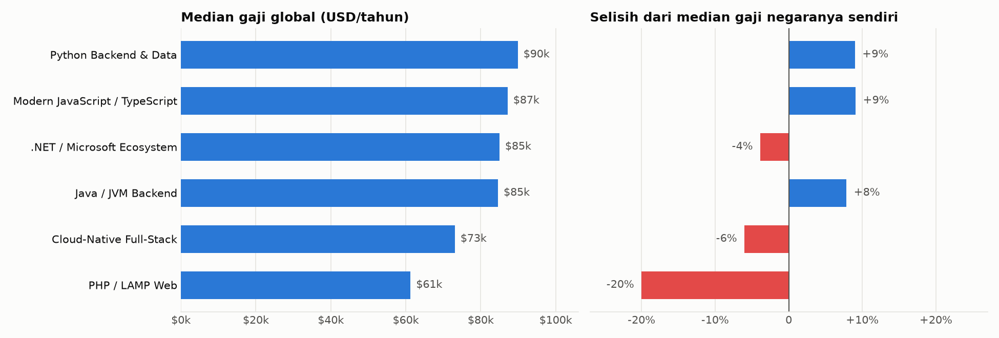
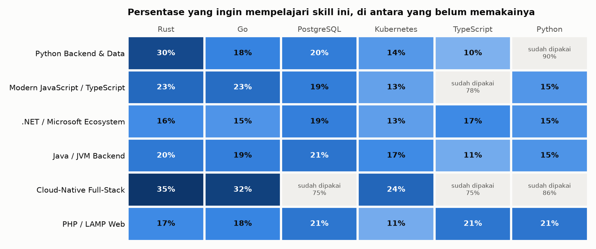

# DevPath: Career Profile Segmentation System

Sistem segmentasi profil karir developer berbasis unsupervised machine learning. DevPath mengelompokkan developer ke dalam 6 persona berdasarkan tech stack nyata dari ~23.000 profesional (Stack Overflow Developer Survey 2025), lalu menghasilkan rekomendasi skill gap serta learning roadmap.

| Bidang | Yang dikerjakan |
|---|---|
| Data analysis | EDA 49.191 responden, *cleaning*, analisis gaji per persona dengan kontrol negara, dan analisis minat skill. Lihat [Hasil Analisis Data](#hasil-analisis-data). |
| Machine learning | *Multi-hot encoding* 186 fitur, UMAP dengan metrik Jaccard, K-Means dengan K=6, serta evaluasi *silhouette*, DBI, dan *purity*. |
| Aplikasi | Flask API dan *frontend* satu file untuk rekomendasi *skill gap* dan *learning roadmap*. |

---

## Latar Belakang

Mahasiswa dan developer baru sering kali kebingungan dalam menentukan karir mereka akibat terlalu banyaknya cabang Computer Science dengan ratusan skills teknologi di masing-masing cabang. Rekomendasi yang tersedia umumnya bersifat generik, tidak berbasis data nyata.

DevPath menjawab pertanyaan: **"Saya cocok ke kelompok developer mana, dan skill apa yang perlu saya pelajari selanjutnya?"** dengan mencocokkan profil skill pengguna terhadap pola nyata dari ~23.000 developer profesional.

---

## Demo

- Aplikasi: [trydevpath.vercel.app](https://trydevpath.vercel.app/)
- Showreel: [DevPath Showreel](https://www.youtube.com/watch?v=vc6671Dv2hI)

---

## Hasil Analisis Data

Sebelum membangun model, saya menganalisis data survei untuk dua tujuan: memastikan datanya layak dipakai dan membaca pola karir di tiap persona. Persona adalah kelompok developer dengan *tech stack* yang mirip, hasil *clustering* di notebook 03. Contohnya, 93% anggota persona Java / JVM Backend memakai Java dan 63% memakai Spring Boot. Semua grafik dan angka di bawah bisa dibuat ulang dengan `python scripts/build_insights.py`. Proses EDA lengkap ada di [`notebooks/01_EDA.ipynb`](notebooks/01_EDA.ipynb).

### 1. Kualitas data dan *cleaning*

*Missing value* adalah kolom yang tidak diisi responden. Contohnya, 66,9% responden tidak mengisi kolom AI Models dan 53,3% tidak mengisi Webframe. Kolom bahasa pemrograman paling lengkap, tetapi tetap kosong di 35,6% responden.



Responden dengan banyak kolom kosong tidak bisa langsung dipakai. Model akan membaca kolom kosong sebagai "tidak memakai database apa pun", padahal artinya "tidak menjawab". Persona orang tersebut lalu ditebak dari profil yang tidak lengkap. Karena itu saya menyaring data dalam dua tahap:

1. Hapus responden yang tidak mengisi bahasa pemrograman. Kolom ini menjadi syarat utama karena paling lengkap. Data turun dari 49.191 menjadi 31.671 responden.
2. Hapus responden yang mengosongkan 2 atau lebih dari 4 kolom inti lainnya, yaitu Webframe, Database, Platform, dan DevEnvs. Data turun lagi menjadi 23.387 responden, atau 47,5% dari data mentah.

AI Models sengaja tidak dijadikan syarat. Kalau keenam kolom wajib terisi, data yang tersisa hanya 20,8%. Aturan di atas mempertahankan lebih dari dua kali lipat jumlah itu. AI Models tetap dipakai sebagai fitur tambahan bagi responden yang mengisinya.

### 2. Gaji per persona

Gaji developer sangat bergantung pada negara tempat ia bekerja. Median gaji responden Amerika Serikat $150k, sedangkan India $24k. Masalahnya, porsi responden AS di tiap persona tidak sama. Persona .NET punya porsi terbesar (25%), sementara PHP hanya 15%. Kalau dibandingkan secara global, persona dengan banyak responden AS akan terlihat bergaji tinggi hanya karena lokasinya.

Selisih dari median negara adalah perbandingan gaji seorang developer dengan nilai tengah gaji di negaranya sendiri. Contohnya, developer di India dibandingkan dengan median India ($24k), bukan dengan median global ($82k). Grafik kanan memakai ukuran ini. Saya hanya menghitung negara dengan minimal 30 data gaji, karena median dari data yang lebih sedikit mudah berubah.



Urutannya berubah kalau gaji dibandingkan per negara. Secara global, .NET setara Java di $85k. Terhadap median negaranya, .NET justru 4% di bawah, sedangkan Java 8% di atas. Python dan JavaScript/TypeScript juga 9% di atas median negaranya.

PHP / LAMP tetap paling rendah, yaitu 20% di bawah median negaranya. Ini selisih terbesar di antara 6 persona. Jadi lokasi responden saja tidak cukup untuk menjelaskan gaji PHP yang rendah.

Cloud-Native Full-Stack juga berada di bawah median negaranya, yaitu 6%. Persona ini paling junior. Sebanyak 30% anggotanya berusia di bawah 25 tahun, sedangkan persona lain hanya 9 sampai 16%. Median pengalaman coding-nya juga paling pendek, yaitu 12 tahun. Gaji yang lebih rendah sejalan dengan profil yang lebih junior ini.

### 3. Profil per persona

Persona JavaScript/TypeScript paling banyak bekerja *remote* penuh, yaitu 47% dari yang menjawab. Persona lain berkisar 28 sampai 33%. Rata-rata kepuasan kerja hampir sama di semua persona, antara 7,1 dan 7,3 dari skala 10. Dengan selisih sekecil ini, saya tidak bisa menyebut satu *stack* lebih memuaskan.

| Persona | Responden | Median lama coding | Usia < 25 | *Remote* penuh | Kepuasan kerja (0-10) | Median gaji | Selisih dari median negara |
|---|---:|---:|---:|---:|---:|---:|---:|
| Python Backend & Data | 4.236 (18%) | 15 tahun | 14% | 32% | 7,2 | $90k | +9% |
| Modern JavaScript / TypeScript | 4.326 (18%) | 13 tahun | 13% | 47% | 7,2 | $87k | +9% |
| .NET / Microsoft Ecosystem | 5.100 (22%) | 18 tahun | 9% | 31% | 7,3 | $85k | -4% |
| Java / JVM Backend | 3.262 (14%) | 16 tahun | 11% | 28% | 7,1 | $85k | +8% |
| Cloud-Native Full-Stack | 3.281 (14%) | 12 tahun | 30% | 33% | 7,3 | $73k | -6% |
| PHP / LAMP Web | 3.182 (14%) | 15 tahun | 16% | 33% | 7,1 | $61k | -20% |

### 4. Minat skill per persona

Minat skill adalah persentase anggota persona yang belum memakai suatu skill, tetapi ingin mempelajarinya. Datanya berasal dari kolom `LanguageWantToWorkWith` dan lima kolom sejenis di survei. Contohnya, 35% developer Cloud-Native yang belum memakai Rust ingin mempelajarinya.

Kolom-kolom itu juga diisi oleh orang yang sudah memakai sebuah skill dan ingin terus memakainya. Kalau mereka ikut dihitung, skill yang sudah umum akan selalu berada di urutan atas. Contohnya, 90% persona Python Backend & Data sudah memakai Python, jadi Python tidak perlu direkomendasikan lagi ke persona itu. Karena itu saya hanya menghitung anggota yang belum memakainya. Skill yang sudah dipakai 70% atau lebih anggota persona diberi warna abu-abu di grafik.



Rust dan Go paling diminati di persona Cloud-Native, masing-masing 35% dan 32%. Rust juga diminati 30% developer Python Backend & Data yang belum memakainya. PostgreSQL diminati 19 sampai 21% di lima persona. Persona keenam, Cloud-Native, tidak dihitung karena 75% anggotanya sudah memakai PostgreSQL. Data minat ini ikut menentukan urutan *learning roadmap* di aplikasi DevPath.

### 5. Dari analisis ke keputusan model

| Temuan EDA | Keputusan | Akibat kalau tidak dilakukan |
|---|---|---|
| *Full-stack* mendominasi 28,3% data `DevType` | Nama persona diambil dari skill teratas tiap *cluster* | 5 dari 6 *cluster* akan bernama *Full-Stack* |
| Rata-rata responden hanya memakai 14 dari 186 fitur, jadi 92,4% isi matriks bernilai nol (*sparse*) | Dimensi direduksi dengan UMAP (metrik Jaccard) sebelum K-Means | Alternatifnya, SVD, hanya mencapai *silhouette* 0,03, dibanding 0,40 dengan UMAP |
| AI Models kosong di 66,9% responden | Dipakai sebagai fitur tambahan, bukan syarat *cleaning* | Data yang tersisa hanya 20,8% |

### 6. Metode dan batasan

Data gaji berasal dari kolom `ConvertedCompYearly`, yaitu gaji tahunan yang sudah dikonversi ke USD oleh Stack Overflow. Saya hanya memakai gaji antara $5k dan $500k untuk membuang *outlier*. Filter ini sama dengan notebook modelling, jadi angkanya cocok dengan yang tampil di aplikasi. Data survei bersifat *self-reported*, dan responden memilih sendiri untuk ikut. Karena itu, temuan di atas menunjukkan hubungan, bukan sebab-akibat.

---

## Cara Kerja Sistem

```
User Input (skill)
      │
      ▼
Multi-hot Binary Encoding        → 186-dim binary vector
      │                            (42 lang + 28 wf + 30 db + 42 plat + 27 env + 17 ai)
      ▼
UMAP Transform (Jaccard)         → 15-dim dense embedding
      │                            (menggunakan model yang sudah di-fit dari training data)
      ▼
K-Means Predict (K=6)            → cluster_id (0–5)
      │
      ├─→ Persona Label           "Python Backend & Data Developer"
      ├─→ Confidence Score        softmax atas jarak ke seluruh centroid
      ├─→ Trait Coverage          cakupan skill inti cluster per kategori
      ├─→ Skill Gap               skill prevalent di cluster yang belum dimiliki user
      └─→ Learning Roadmap        gap diranking ulang dengan sinyal WantToWorkWith
```

---

## Local Run

```bash
git clone https://github.com/SauHin/DevPath.git && cd DevPath
python -m venv .venv && .venv/Scripts/activate   # Linux/macOS: source .venv/bin/activate
pip install -r requirements.txt
python app.py
```

Buka `http://127.0.0.1:5000`. Startup butuh sekitar 30 detik pada run pertama: load
UMAP 77 MB lalu memanggilnya sekali untuk trigger JIT numba. Setelah itu
tiap prediksi berjalan di bawah 10 ms.

Cek status API: `curl localhost:5000/api/health`

| Variabel        | Default             | Guna                                       |
|-----------------|---------------------|--------------------------------------------|
| `PORT`          | `5000`              | Port HTTP                                  |
| `HOST`          | `127.0.0.1`         | Set `0.0.0.0` untuk diakses dari luar       |
| `DEVPATH_DEBUG` | off                 | `1` untuk mode debug Flask                  |
| `DEVPATH_OUT_DIR` | `./Outputs`       | Lokasi `artifacts/`, `models/`, `templates/`|

Test: `python tests/test_api.py` (atau `pytest tests/`).

---

## Dataset

| Atribut         | Detail                                             |
|-----------------|----------------------------------------------------|
| Sumber          | Stack Overflow Developer Survey 2025               |
| Format          | CSV (6 part file)                                  |
| Total Raw       | 49.191 responden                                   |
| Setelah Cleaning| 23.387 responden (47,5% retensi)                   |
| Kolom           | 172 kolom per part                                 |

Sumber: [Stack Overflow Annual Developer Survey](https://survey.stackoverflow.co/)

---

## Struktur Project

```
DevPath/
│
├── notebooks/
│   ├── 01_EDA.ipynb                     # Exploratory Data Analysis
│   ├── 02_FeatureExtraction_Preprocessing.ipynb
│   ├── 03_Modeling.ipynb                # Training, evaluasi, simpan model
│   └── 04_ApplicationLayer.ipynb        # Generate app files + deploy
│
├── app.py                               # Flask backend
├── requirements.txt
├── Dockerfile                           # target Hugging Face Spaces
├── PRODUCT.md                           # kebenaran produk (audiens, batasan, bukti)
├── DESIGN.md                            # sistem desain, ditulis dari build
│
├── scripts/
│   ├── build_profiles.py                # prevalensi 186 skill + sinyal WantToWorkWith
│   ├── build_examples.py                # stack contoh nyata per cluster (kartu landing)
│   ├── build_insights.py                # grafik & tabel "Hasil Analisis Data"
│   └── build_knn_index.py               # eksperimen pengganti UMAP (lihat catatan Deploy)
│
├── docs/insights/                       # grafik analisis data untuk README
│
├── tests/
│   └── test_api.py
│
├── Outputs/                             
│   ├── artifacts/
│   │   ├── mlb_encoders.pkl             # Fitted MultiLabelBinarizer (6 kolom)
│   │   ├── umap_model.pkl               # Fitted UMAP reducer (Jaccard, 15 dim)
│   │   ├── kmeans_final.pkl             # Fitted K-Means (K=6)
│   │   ├── feature_names.json           # 186 nama fitur binary
│   │   ├── persona_labels.json          # cluster_id untuk nama persona
│   │   ├── cluster_prevalence.json      # prevalensi & minat 186 skill per cluster
│   │   ├── persona_descriptions.json    # deskripsi persona, di-key cluster_id
│   │   └── model_config.json            # Hyperparameter & metrik final
│   │
│   ├── templates/
│   │   └── index.html                   # Frontend: satu file, tanpa build step
│   │
│   ├── static/fonts/                    # dua typeface woff2 self-hosted
│   │
│   └── models/
│       ├── cluster_profiles.json        # Profil lengkap 6 cluster
│       ├── cluster_assignments.csv      # Label cluster per respondent
│       └── dataset_with_clusters.csv    # Dataset dengan cluster label
│
└── Dataset/                          
    ├── part_1_SO_survey.csv
    ├── part_2_SO_survey.csv
    ├── part_3_SO_survey.csv
    ├── part_4_SO_survey.csv
    ├── part_5_SO_survey.csv
    └── part_6_SO_survey.csv
```
